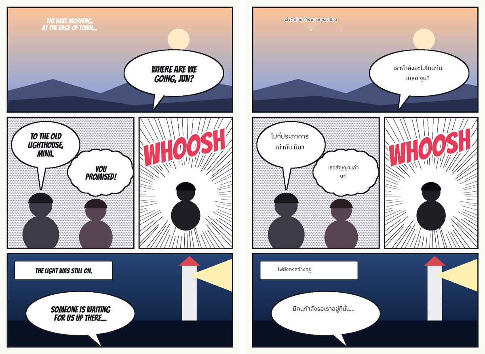
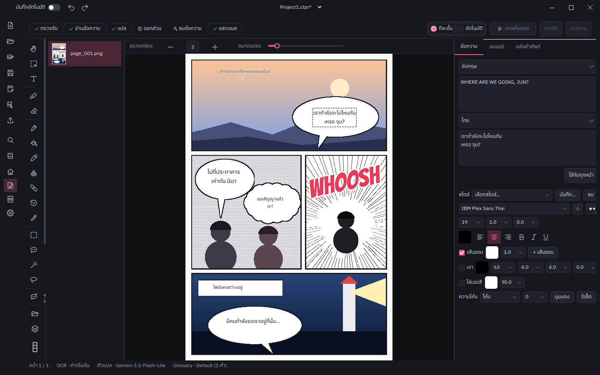
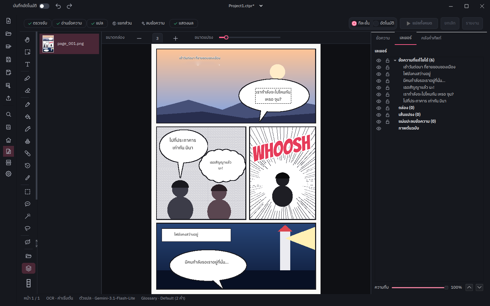
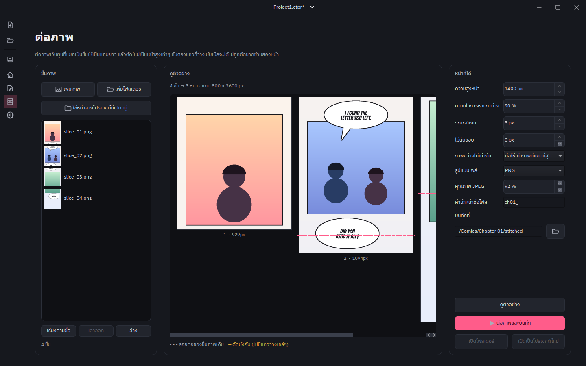
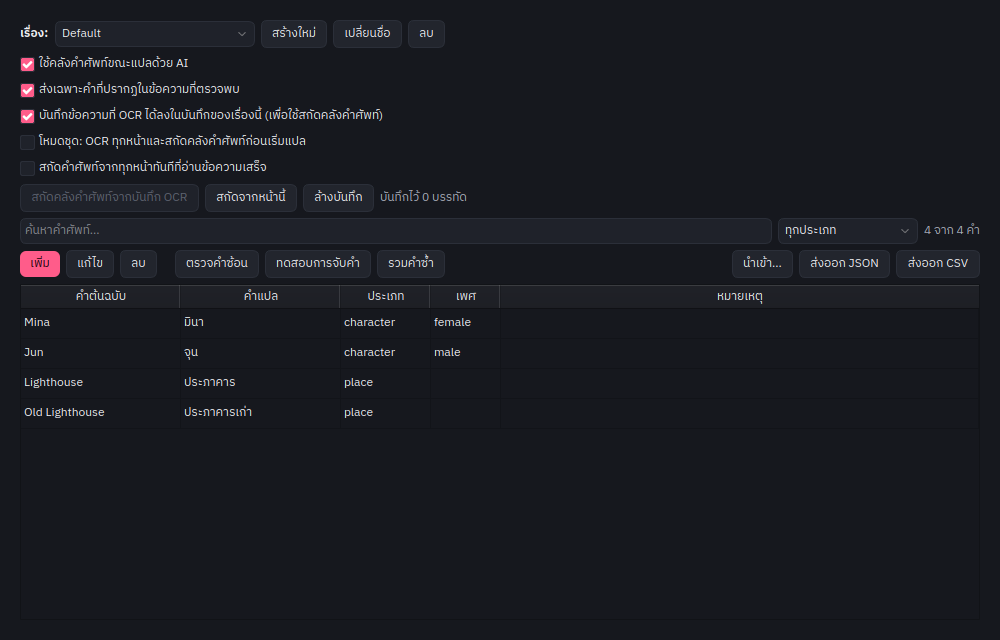
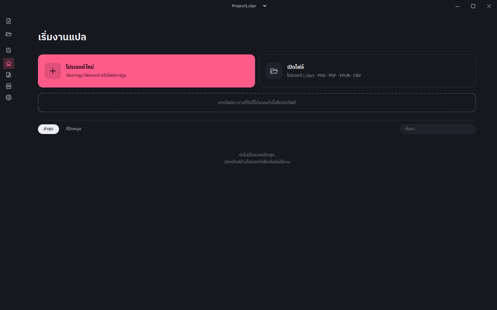
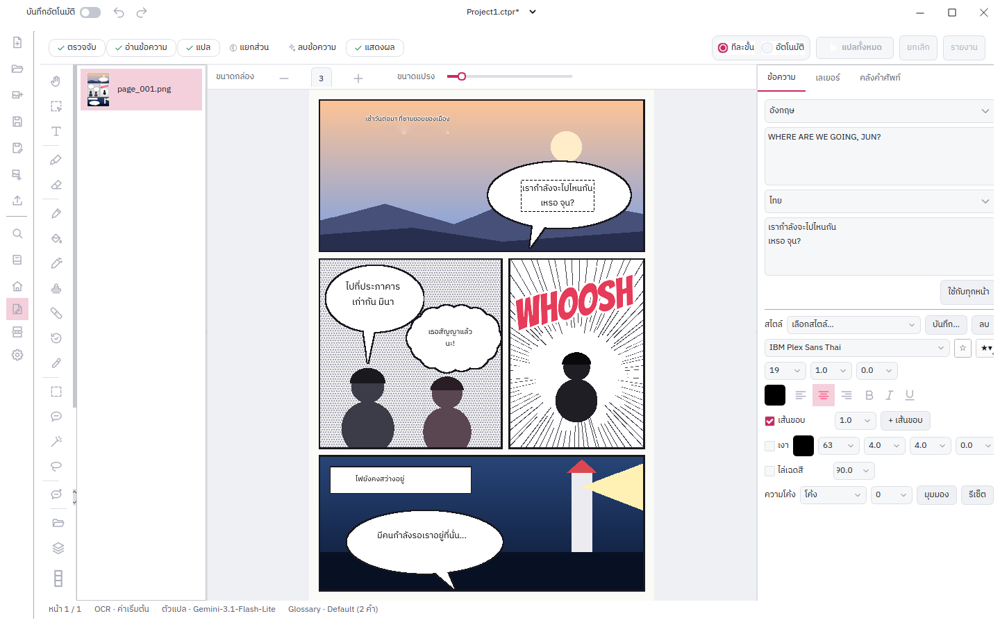

<div align="center">


# Toon Studio

**แปลมังงะ มันฮวา เว็บตูน และคอมิกส์ ด้วย AI — แล้วแก้ต่อได้เหมือนโปรแกรมแต่งภาพ**<br>
Translate manga, manhwa, webtoons and comics with AI — then finish them in a real editor.

[](https://github.com/Banchon999/ToonStudio/releases/latest)
[](https://github.com/Banchon999/ToonStudio/actions/workflows/test.yml)
[](LICENSE)



<sub>หน้าเดโมที่วาดขึ้นเอง แปลจริงด้วย Toon Studio: ตรวจจับ → OCR → แปล → ลบข้อความ → วางข้อความไทย · A demo page drawn for this README, translated end to end by the app.</sub>

</div>

---

- [ทำอะไรได้ / What it does](#ทำอะไรได้--what-it-does)
- [จุดเด่น / Highlights](#จุดเด่น--highlights)
- [ภาพหน้าจอ / Screenshots](#ภาพหน้าจอ--screenshots)
- [ดาวน์โหลด / Download](#ดาวน์โหลด--download)
- [เริ่มใช้งาน / Quick start](#เริ่มใช้งาน--quick-start)
- [เอนจินและภาษา / Engines and languages](#เอนจินและภาษา--engines-and-languages)
- [รันจากซอร์ส / Run from source](#รันจากซอร์ส--run-from-source)
- [เคล็ดลับและคีย์ลัด / Tips and shortcuts](#เคล็ดลับและคีย์ลัด--tips-and-shortcuts)
- [สัญญาอนุญาตและเครดิต / License and credits](#สัญญาอนุญาตและเครดิต--license-and-credits)

## ทำอะไรได้ / What it does

Toon Studio ทำงานเป็นขั้นตอนเดียวกับคนแปลการ์ตูน: **ตรวจจับ** บอลลูนและข้อความ → **อ่าน** ข้อความ (OCR) → **แปล** ด้วย AI ที่เห็นทั้งหน้า → **ลบ** ข้อความเดิมออกจากภาพ → **วาง** คำแปลกลับลงในบอลลูน
<br>It follows a translator's own workflow: **detect** bubbles and text → **read** them (OCR) → **translate** with an AI that sees the whole page → **clean** the original lettering → **render** the translation back into each bubble.

- **อัตโนมัติ** — กด "แปลทั้งหมด" แล้วปล่อยให้ทำทั้งเล่ม · **Automatic**: press *Translate All* and let it run through every page.
- **ทีละขั้น** — กดทีละปุ่ม ตรวจและแก้ผลแต่ละขั้นก่อนไปต่อ · **Step by step**: run one stage at a time and correct each before the next.

ผลทุกอย่างแก้ได้ภายหลัง: กล่องข้อความ ฟอนต์ เลเยอร์ และส่วนที่ลบ · Everything stays editable afterwards — text boxes, fonts, layers and every cleaned patch.

## จุดเด่น / Highlights

**แปลไทยที่ถูกเพศ / Thai that knows who is speaking**
- AI บอกว่าใครพูดแต่ละบอลลูนและเพศอะไร ใช้คุม ครับ/ค่ะ, ผม/ดิฉัน, เขา/เธอ และคำเรียกอย่าง คุณชาย/คุณหนู · Translating into Thai, the AI reports each bubble's speaker and gender and follows the rules for particles, pronouns and forms of address.
- เตือนเมื่อบอลลูนใช้ ครับ กับ ค่ะ ปนกัน หรือไม่ตรงกับเพศคนพูด — เตือนเท่านั้น ไม่แก้ให้เอง · Warns, never rewrites, when a bubble mixes particles or contradicts its speaker.

**คลังคำศัพท์ต่อเรื่อง / A glossary per series**
- ชื่อตัวละคร สถานที่ สกิล ถูกส่งให้ AI ทุกครั้งที่ปรากฏในหน้า จับได้แม้ OCR เว้นวรรคผิดหรืออ่านผิดหนึ่งตัวอักษร · Names, places and skills are sent whenever they appear, even when OCR splits a name or misreads one letter.
- เตือนเมื่อคำแปลไม่ได้ใช้คำในคลัง, เตือนคำที่ซ้อนกันแล้วแปลขัดกัน, สกัดคำศัพท์ใหม่จากหน้าที่อ่านแล้วด้วย AI · Warns when a translation ignores the glossary, flags overlapping terms that disagree, and can extract new terms from what was read.

**เว็บตูน / Webtoons**
- แปลทั้งแถบในคำขอเดียว AI เห็นบทสนทนาทั้งตอน — ทดสอบกับ AI จริง ระบุคนพูดถูก 14/14 (เดิมแปลทีละช่วงได้ 6–8) · A whole strip is translated in one request, so the model follows the conversation: 14 of 14 speakers right on a test strip, against 6–8 chunk by chunk.
- **หน้าต่อภาพ (Stitch)** ต่อไฟล์ที่ถูกตัดมาแบบสุ่มเป็นแถบเดียว แล้วตัดใหม่ตรงช่องว่าง ไม่ผ่ากลางบอลลูน · The **Stitch** page joins slices cut wherever the uploader cut them and re-cuts the strip at blank rows, never through a bubble.

**ตัวแก้ไขแบบโปรแกรมแต่งภาพ / A real editor**
- เลเยอร์ (ซ่อน/ล็อก/ความทึบ), เอฟเฟกต์ข้อความ (เส้นขอบหลายชั้น เงา ไล่สี โค้ง/warp มุมมอง), สไตล์สำเร็จรูป · Layers with visibility, locks and opacity; stacked strokes, shadow, gradient, warp and perspective text; style presets.
- เครื่องมือเลือกพื้นที่ (กล่อง/ไม้กายสิทธิ์/บ่วงบาศ/คลิกบอลลูน), แปรงระบายสี, คืนภาพเดิม, ถังเทสี, แปรง AI ลบ, clone stamp, healing brush, ลบข้อความในบอลลูนขาวทั้งหน้าในคลิกเดียว · Selections (marquee, wand, lasso, one-click balloon), paint, restore, fill, AI inpaint brush, clone stamp, healing brush, and *Clean White Balloons* for a whole page at once.

**ลบข้อความได้เนียน / Clean that holds up**
- บอลลูนสีพื้น ไล่สี และตัวอักษรเรืองแสงถูกเติมให้กลืนกับพื้นรอบข้าง ส่วนที่เป็นลายหรือภาพวาดส่งต่อให้ AI (AOT / LaMa) · Flat, gradient and glowing lettering is filled from its surroundings; patterned art goes to an inpainting model (AOT, LaMa).

**ส่งออก / Export**
- PNG/JPG, **PSD ที่ข้อความยังแก้ได้** (เปิดใน Photoshop/Photopea), CBZ, PDF, ZIP และไฟล์ข้อความแปล · Images, **PSD with editable type layers**, CBZ, PDF, ZIP and the translations as text.
- เปิดได้จากรูป โฟลเดอร์ PDF/EPUB ไฟล์บีบอัด CBZ/CBR และ PSD · Opens images, folders, PDF/EPUB, archives, CBZ/CBR and PSD.

## ภาพหน้าจอ / Screenshots

<table>
<tr>
<td width="50%"><br><sub><b>ตัวแก้ไข</b> — แถบขั้นตอน เครื่องมือด้านซ้าย ช่องตรวจข้อความด้านขวา · <b>Editor</b>: step bar, tool rail, inspector.</sub></td>
<td width="50%"><br><sub><b>เลเยอร์</b> — ทุกกล่องข้อความและส่วนที่ลบเป็นเลเยอร์ของตัวเอง · <b>Layers</b>: every text box and cleaned patch is its own layer.</sub></td>
</tr>
<tr>
<td><br><sub><b>ต่อภาพ</b> — เส้นประคือรอยตัดเดิม เส้นทึบคือรอยตัดใหม่ · <b>Stitch</b>: dashed = where the slices were cut, solid = the new cuts.</sub></td>
<td><br><sub><b>คลังคำศัพท์</b> — ชื่อ เพศ และประเภทของแต่ละคำ · <b>Glossary</b>: each term with its type and gender.</sub></td>
</tr>
<tr>
<td><br><sub><b>หน้าแรก</b> · <b>Home</b></sub></td>
<td><br><sub><b>ธีมสว่าง</b> · <b>Light theme</b></sub></td>
</tr>
</table>

## ดาวน์โหลด / Download

ดาวน์โหลดเวอร์ชันล่าสุดจากหน้า **[Releases](https://github.com/Banchon999/ToonStudio/releases/latest)** · Get the latest build from **[Releases](https://github.com/Banchon999/ToonStudio/releases/latest)**.

| | |
|---|---|
| Windows 10/11 (64-bit) | `ToonStudio-Windows-x86_64.zip` — แตกไฟล์แล้วเปิด `ToonStudio.exe` · unzip and run `ToonStudio.exe` |
| Linux (x86_64) | `ToonStudio-Linux-x86_64.tar.gz` — แตกไฟล์แล้วรัน `./ToonStudio/ToonStudio` · extract and run `./ToonStudio/ToonStudio` |
| macOS 15+ (Apple Silicon) | `ToonStudio-macOS-arm64.dmg` — ลาก Toon Studio ไปที่ Applications · drag Toon Studio to Applications |

- **Windows:** ถ้า SmartScreen เตือน กด *More info → Run anyway* · If SmartScreen warns, choose *More info → Run anyway*.
- **macOS:** ครั้งแรกให้ไปที่ System Settings → Privacy & Security แล้วกด **Open Anyway** (แอปไม่ได้ผ่าน notarisation ของ Apple) · The first time, go to System Settings → Privacy & Security and click **Open Anyway** (the app is not notarised). Intel Macs are not supported.
- แอปจะแจ้งเมื่อมีเวอร์ชันใหม่ · The app tells you when a new version is out.

## เริ่มใช้งาน / Quick start

1. **เปิดงาน** — หน้าแรก → *โปรเจกต์ใหม่* หรือลากรูป/โฟลเดอร์/ไฟล์ลงในหน้าต่าง · **Open your pages**: *New Project* on the home screen, or drop images, a folder or an archive onto the window.
2. **เลือกภาษา** ต้นฉบับและภาษาเป้าหมายที่แถบด้านบน · **Pick the languages** in the top bar.
3. **ใส่คีย์ AI** — ตั้งค่า → *Credentials* → **OpenRouter**: คีย์เดียวใช้ได้ทั้ง OCR และการแปล และเลือกโมเดล OCR แยกจากโมเดลแปลได้ (เช่นใช้รุ่นถูกสำหรับ OCR) · **Add an AI key**: Settings → *Credentials* → **OpenRouter**. One key covers OCR and translation, with a separate OCR model field so a cheap vision model can read while a stronger one translates. GPT, Claude, Gemini, DeepSeek and any OpenAI-compatible endpoint (*Custom*) work too.
4. **แปล** — กด **แปลทั้งหมด** (อัตโนมัติ) หรือสลับเป็น **ทีละขั้น** แล้วกด ตรวจจับ → อ่านข้อความ → แปล → ลบข้อความ → แสดงผล · **Translate**: *Translate All*, or switch to step by step and run Detect → OCR → Translate → Clean → Render.
5. **แก้ไข** ข้อความ ฟอนต์ ตำแหน่ง หรือภาพ ด้วยเครื่องมือด้านซ้ายและช่องตรวจด้านขวา · **Polish** text, fonts, placement or artwork with the tool rail and the inspector.
6. **ส่งออก** เป็นรูป PSD CBZ หรือ PDF · **Export** to images, PSD, CBZ or PDF.

> ตั้งค่าเรื่องที่แปลประจำ (โฟลเดอร์ คลังคำศัพท์ สไตล์ prompt คู่ภาษา) เป็น **Workspace** แล้วสลับได้ในคลิกเดียว · Save a series' folders, glossary, prompt style and language pair as a **Workspace** and switch between series in one click.

## เอนจินและภาษา / Engines and languages

| ขั้นตอน / Stage | ตัวเลือก / Options |
|---|---|
| ตรวจจับ / Detection | RT-DETR-v2 (บอลลูน + ข้อความ) · RT-DETR-v2 + Bubble Seg |
| OCR | ค่าเริ่มต้นตามภาษา (manga-ocr ญี่ปุ่น, Pororo เกาหลี, PaddleOCR อื่นๆ) · PaddleOCR / PaddleOCR (Server) · Pororo · Microsoft OCR · Gemini · **OpenRouter** (โมเดลใดก็ได้ที่อ่านภาพได้) · EasyOCR และ PaddleOCR-VL (ติดตั้งเพิ่ม) |
| แปล / Translation | Gemini 3.1 Flash-Lite · GPT-4.1 / 4.1-mini · Claude 4.6 Sonnet / 4.5 Haiku · DeepSeek · **OpenRouter** · Custom (OpenAI-compatible) |
| ลบข้อความ / Cleaning | เติมพื้นอัตโนมัติก่อนเสมอ แล้ว AOT · LaMa · Smart Fill สำหรับส่วนที่เหลือ · fast background fill first, then AOT, LaMa or Smart Fill |
| วางข้อความ / Rendering | Skia หรือ Qt, ตัดคำไทยด้วย pythainlp, ตัวอักษรแนวตั้งสำหรับจีน/ญี่ปุ่น · Skia or Qt, Thai word breaking, vertical CJK |

**ภาษาต้นฉบับและปลายทาง / Languages:** English, 한국어, 日本語, 简体中文, 繁體中文, Français, Deutsch, Español, Italiano, Русский, ไทย, Tiếng Việt, Bahasa Indonesia, Türkçe, Polski, Português, العربية, עברית และอื่นๆ (ทิศทางขวา-ซ้ายรองรับ) · and more, including right-to-left scripts.

**ภาษาของหน้าจอ / UI languages:** ไทย, English, 한국어, Français, 简体中文, Русский, 日本語, Deutsch, Español, Italiano.

## รันจากซอร์ส / Run from source

ต้องมี Python 3.12, git และ [uv](https://docs.astral.sh/uv/getting-started/installation/) · Needs Python 3.12, git and uv.

```bash
git clone https://github.com/Banchon999/ToonStudio
cd ToonStudio
uv init --python 3.12
uv add -r requirements.txt --compile-bytecode
uv run comic.py
```

ตัวเลือกเพิ่มเติม / Optional:

```bash
uv pip install onnxruntime-gpu                         # การ์ดจอ NVIDIA · NVIDIA GPU acceleration
uv pip install torch torchvision "transformers>=5"     # เปิดใช้ PaddleOCR-VL · enables PaddleOCR-VL
```

อัปเดต: `git pull` แล้ว `uv add -r requirements.txt --compile-bytecode` · To update, pull and re-run the install line.

นักพัฒนา / Developers: `uv pip install -r requirements-dev.txt`, then `pytest` and `ruff check .`. Architecture notes live in [CLAUDE.md](CLAUDE.md); the images in this README are regenerated by `scripts/build_readme_images.py`.

## เคล็ดลับและคีย์ลัด / Tips and shortcuts

| | |
|---|---|
| `Ctrl+S` / `Ctrl+E` | บันทึกโปรเจกต์ / บันทึกรูปที่เปิดอยู่ · Save project / save current image |
| `Ctrl+Z` / `Ctrl+Y` | ย้อนกลับ / ทำซ้ำ · Undo / redo |
| `Ctrl+A` / `Ctrl+Shift+A` / `Ctrl+Shift+I` | เลือกทั้งหน้า / ยกเลิกการเลือก / กลับด้าน · Select all / deselect / invert |
| `Alt`+คลิก | ดูดสีขณะระบาย, ตั้งจุดต้นทางของ clone stamp · Pick a colour while painting, set the clone source |
| `Ctrl`+ล้อเมาส์ | ซูม · Zoom |
| `←` `→` | เปลี่ยนหน้า · Previous / next page |

- เลือกฟอนต์ที่มีตัวอักษรภาษาเป้าหมาย (เช่น ฟอนต์ไทยสำหรับคำแปลไทย) นำเข้าฟอนต์ของตัวเองได้ที่ ตั้งค่า → การแสดงข้อความ · Pick a font that covers the target language; import your own under Settings → Text Rendering. ทุกคีย์ลัดเปลี่ยนได้ใน ตั้งค่า → คีย์ลัด · Every shortcut can be changed under Settings → Shortcuts.
- ไฟล์ CBR ต้องมี WinRAR หรือ 7-Zip อยู่ใน PATH · CBR files need WinRAR or 7-Zip on your PATH.

## สัญญาอนุญาตและเครดิต / License and credits

Toon Studio เผยแพร่ภายใต้ **GPL-3.0-or-later** ([LICENSE](LICENSE)) · Toon Studio is distributed under the GPL-3.0-or-later.

- พัฒนาต่อจาก [comic-translate](https://github.com/ogkalu2/comic-translate) ของ ogkalu2 (Apache-2.0, [LICENSE-Apache-2.0](LICENSE-Apache-2.0)) · A fork of ogkalu2's comic-translate (Apache-2.0).
- การลบข้อความบางส่วนดัดแปลงจาก [PanelCleaner](https://github.com/VoxelCubes/PanelCleaner) (GPL-3.0) · Parts of the cleaning code are adapted from PanelCleaner. รายละเอียดใน [NOTICE.md](NOTICE.md) · Details in NOTICE.md.

ขอบคุณโมเดลและไลบรารีเหล่านี้ / Built on:
[comic-text-and-bubble-detector](https://huggingface.co/ogkalu/comic-text-and-bubble-detector) ·
[comic-text-detector](https://github.com/dmMaze/comic-text-detector) ·
[manga-ocr](https://github.com/kha-white/manga-ocr) ·
[Pororo OCR](https://github.com/yunwoong7/korean_ocr_using_pororo) ·
[PaddleOCR](https://github.com/PaddlePaddle/PaddleOCR) ·
[RapidOCR](https://github.com/RapidAI/RapidOCR) ·
[EasyOCR](https://github.com/JaidedAI/EasyOCR) ·
[lama-cleaner](https://github.com/Sanster/lama-cleaner) ·
[AnimeMangaInpainting](https://huggingface.co/dreMaz) ·
[PanelCleaner](https://github.com/VoxelCubes/PanelCleaner) ·
[PyThaiNLP](https://github.com/PyThaiNLP/pythainlp) ·
[skia-python](https://github.com/kyamagu/skia-python) ·
[PhotoshopAPI](https://github.com/EmilDohne/PhotoshopAPI) ·
[dayu_widgets](https://github.com/phenom-films/dayu_widgets) ·
[IBM Plex Sans Thai](https://github.com/IBM/plex)
